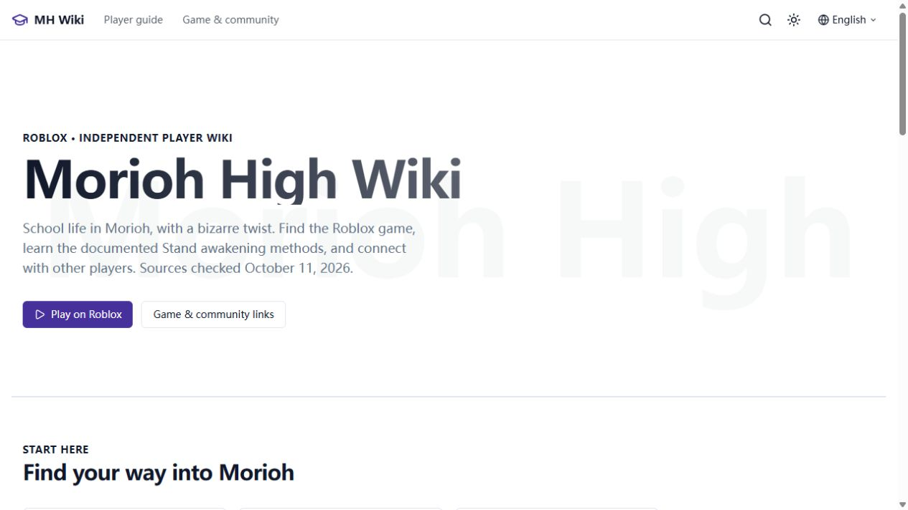

# Morioh High Wiki 实际交付报告

2026-10-11，Asia/Shanghai。当前是已经实际部署、可访问、通过质量门禁的限定首版；**完整游戏百科和正式域名上线尚未完成**。已完成指动作结束，已验证指实际检查确认；未完成、未验证、外部阻塞不会写成成功。

## 1. AnvilWiki 版本及来源

已验证：[AnvilWiki](https://github.com/PNGTRID/AnvilWiki) **2.37.0**，commit **b00859a524a176d60f3982c71b318ac11bc2fd5b**，MIT；保留 LICENSE 和归属。实际运行官方 apply-template，使用原生 Astro7.3.2、MDX8.0.1、Pagefind、文章/首页组件、目录、面包屑、SEO及预留广告组件。英语唯一版本、静态构建、广告关闭。Node22.19.0 / pnpm11.1.1；模板要求 Node>=22.13。来源、README/AGENTS/docs及技能核对见 [template-provenance](../research/template-provenance.md)。

## 2. GitHub 与代码版本

已完成并验证：[ChanChunKei/moriohhigh-wiki](https://github.com/ChanChunKei/moriohhigh-wiki)，独立public仓库。实际部署来源 **b1d747968377615aa7fe14a36455c9aa4e935d7c**；[该版本CI](https://github.com/ChanChunKei/moriohhigh-wiki/actions/runs/38140239450) success。最终线上证据和本报告属于后续记录提交，不改变部署来源；不要以记录commit冒充线上代码。

虽然 gh CLI 未登录，本地已有 GCM 身份可用，已用原生Git及授权API完成仓库与push；不再将它报告为账号阻塞。凭据不写入代码或公开报告。

## 3. Cloudflare Pages 实际网址

已完成并验证：[https://moriohhigh-wiki.pages.dev](https://moriohhigh-wiki.pages.dev)。Production部署 **e68613b0-a4c5-4b8b-add3-6191e9c91508**；[不可变部署地址](https://e68613b0.moriohhigh-wiki.pages.dev)，CF API deploy stage success，线上原生deployment marker匹配b1d7479。

这是实际Pages临时地址，**不是已绑定正式域名**。当前以官方Wrangler direct upload部署；GitHub CI已配置，未声称已有GitHub自动生产部署集成。恢复/上传流程见 MAINTENANCE.md、tools/deploy-pages.mjs。

## 4. 正式域名状态

**外部阻塞 / 未完成**：未取得已确认所有权且授权绑定的正式域名。用户指定使用域名邮箱，但具体真实邮箱地址未提供。未购买、付款、绑定或改动不相关DNS。

`moriohhigh.wiki` RDAP已注册于2026-10-11；Cloudflare nameservers不证明用户所有权。已查注册商 `.wiki` 标准续费超过¥100。条件候选 `moriohhighwiki.org / Spaceship` 的公开标准税前参考价约首年¥46.12、续费¥78.03；具体名称可注册、Premium与税费结账价仍未验证，不能称最终合格候选。合格备选不足，没有凑两个。证据与比较见 [domain-selection](../research/domain-selection.md)。

## 5. 关键词总数及有效口径

**36研究记录 / 29相关候选 / 7排除项**。29表示游戏意图相关，不表示取得实测月搜或都应独立建页；当前Suggest有7条信号，其他包括历史证据和未验证需求假设。新月搜和KD未取得，保持null/未知，没有填0。

Google实际主词SERP观察到9个自然结果和图片包，带US/en参数，登录与Colorado位置可能影响；样本竞争判断 **2/5**，不是KD，不替代历史47.7。其他词没有完成Google前十实查，不编造评分。7/30天Trends含GPTs比较HTTP429，实时上涨未验证；Similarweb/付费SEO API数据未取得。

## 6. 用户原研究继承

**已完成**：15词原始数据、KD/热度、历史SERP、优先级、来源口径及限制保存在 [Markdown](../research/user-keywords-2026-10-11.md) 和 [JSON](../research/user-keywords-2026-10-11.json)。新研究独立保存日期/来源，没有改写原数字；未收录、无数据、真实零搜索、Trends相对零仍分开。

## 7–8. 最终页面矩阵、发布页与URL

20独立意图，**6发布 / 14暂缓**；发布页含4完整限定答案、2明确部分答案。法律、归档、标签与404不计精品攻略。主/次词、最小答案、证据、形式、内链、更新频率见 [完整page-matrix](../research/page-matrix.md)。

| 已发布页面 | 实际 URL | 能回答的问题 / 状态 |
|---|---|---|
| Wiki首页 | [首页](https://moriohhigh-wiki.pages.dev/) | 完整限定答案：识别游戏、开发者及可靠内容导航 |
| How to play | [启动指南](https://moriohhigh-wiki.pages.dev/guides/how-to-play/) | 完整限定答案：正确入口、Roblox Player启动；不冒充进度路线 |
| How to get a Stand | [Stand获取](https://moriohhigh-wiki.pages.dev/guides/how-to-get-a-stand/) | 完整文档化答案：合格真实战斗击倒 / Arrow到100%兼容度及已读规则 |
| Release information | [发布信息](https://moriohhigh-wiki.pages.dev/resources/release-information/) | 部分答案：核验时活动状态、报告日期与创建日期区别；官方确切发布日期未知 |
| Community resources | [社区入口](https://moriohhigh-wiki.pages.dev/resources/community-links/) | 部分答案：匹配开发者群组和有效邀请；官方Discord所有权/Trello未知 |
| FAQ | [常见问题](https://moriohhigh-wiki.pages.dev/faq/) | 完整限定答案：8项身份/入口/资源问题，链接详细指南 |

另有About、Privacy、Terms、Copyright，与6编辑页合计10可索引URL；20正常HTML路由，额外404构建文件合计21HTML。归档/标签和没有真实邮箱的Contact noindex，并排除Sitemap。

## 9. 暂缓页及理由

| 候选 | 未达到门禁的理由 |
|---|---|
| Beginner guide | 没有普通玩家当前起步目标与实测路线 |
| Stands guide | 没有完整当前roster与能力数据 |
| Controls | 没有同游戏设备输入/设置证据 |
| Progression | 没有已实装里程碑和解锁证据 |
| Map / locations | 没有当前地图和路线证据 |
| NPCs | 描述只确认互动，不足以做名字/位置图鉴 |
| Quests | 没有核验任务、前置和奖励列表 |
| Abilities | 没有当前技能/数值，原作不能代替 |
| Combat | 同游戏控制/战斗测试不足 |
| Items | 无完整功能/来源台账；Arrow窄答案并入Stand页 |
| Codes | 媒体奖励/状态冲突，无开发者来源及成功兑换验证 |
| Tips | 无独立实测选择，会重复未验证beginner内容 |
| Troubleshooting | 无可复现游戏特有问题；通用启动并入现有页 |
| Tier list | 无当前roster及可重复对比测试；历史相对热度0不是零搜索 |

没有发布上述空壳路由。Script/作弊和无关JoJo城镇百科排除。

## 10. 真实搜索需求覆盖

覆盖历史主词/Wiki/Roblox入口、Stand获取、发布日期、Discord/Trello资源意图。入口/Discord有当前Suggest；Stand获取有当前同游戏视频。FAQ为支持页，独立需求未量化。

主词样本内专门Wiki覆盖仍薄，存在机会假设；没有证据确认热度持续上涨或一定排名。Codes媒体已覆盖，未作唯一策略。准确月搜、长期需求和多个独立机制长尾仍不足，不能把JoJo词量计入本游戏。

## 11. 事实审计

**窄范围审计已完成**：[E01–E18台账](../research/evidence-ledger.md)、[内容审计](content-audit.md)。官方入口 [Roblox Morioh High](https://www.roblox.com/games/111838814545019/Morioh-High)，Place **111838814545019** / Universe **10768944846**；开发者 **Not A Stand Game** / group **403864872**。

E17实际阅读录像0:10同游戏Encyclopedia；E18另一玩家约0:50–1:05 Arrow争夺支撑。1-in-10、一分钟限制、100%兼容度来自可读UI；概率未独立实测，准确build/当前客户端未知。Arrow位置、刷新时间、价格没有猜测。admin SetStand及管理者货币不作正常进度证据。没有复制其他游戏/原作机制、未验证Codes或竞争站段落；全站非官方声明、自制视觉，完整转录/游戏帧只本地留存。

## 12. 视觉审计

**样板已验证**：实际浏览器首页、Stand页、社区数据页，1440×900桌面/390×844移动；导航、Sidebar、Quick Answer、TOC、表格、FAQ、内链、Pagefind，移动菜单/目录实际展开。原移动样板scrollWidth375<=innerWidth390。

线上首页/社区共享移动组件与搜索已查；最新版Stand桌面、搜索4结果及正确跳转已查，verified-live-stand-mobile.png为真实390×700生产首屏。最终再测移动搜索时浏览器辅助超时，未另报重复检查通过。错误的即时视口截图标为诊断图，不作证据。没有真实手机、Lighthouse或真实Core Web Vitals值。[视觉报告](visual-sample-audit.md)。

## 13. 技术测试

| 请求检查 | 实际结果 |
|---|---|
| pnpm check | 已验证通过；136files、0 errors/warnings/hints |
| pnpm lint | 已验证通过 |
| pnpm test | 已验证通过；18suites、244passed /1skipped |
| pnpm check-config | 已验证通过；英语/分类/实际origin匹配 |
| pnpm check-content | 已验证通过；4MDX |
| pnpm check-links | 已验证通过；21HTML、455内链 |
| pnpm check-sitemap | 已验证通过；线上10URLs均200 |
| pnpm build | 已验证通过；21HTML、Pagefind索引4文章 |

额外check-i18n通过；构建SEO **21HTML /10indexable /10sitemap /0failures**；线上 **20HTML路由 /27HTTP目标 /0failures**，HTTPS、Canonical、robots、noindex、404和搜索资源验收通过。

7个保留上游演示/营销测试不适用于已套模板本站，列入templateOnlySuites；一个FORKER警告测试因该块移除跳过。适用SEO/索引/同意加载/链接/内容/配置测试仍运行。[技术审计与限制](technical-audit.md)。构建不是事实正确的证明，内容另行核验。

## 14. Sitemap

[sitemap-index.xml](https://moriohhigh-wiki.pages.dev/sitemap-index.xml) 和 [sitemap-0.xml](https://moriohhigh-wiki.pages.dev/sitemap-0.xml) **已验证200、正确XML类型/命名空间**，10存在且可索引URL均200，无暂缓空页；robots允许抓取并列Sitemap。原生手动IndexNow提交10URLs返回202；不是Google收录。

## 15. GSC / GA4

**GSC已验证**：本站URL-prefix所有权；index/诊断child Sitemap成功提交。**未验证/当前错误**：报告仍Couldn't fetch /0 discovered。20:48:11 Google live inspection显示URL available、Page fetch Successful、Crawl/Indexing allowed Yes；没有证据断言整个站点无法抓取。保留差异，后续查处理，提交不等于处理或收录。[search-console.json](search-console.json)和截图保存齐全。

**GA4实际采集已验证**：property **558434763** / stream **16106218705** / **G-MLLG5CEMCG**。原生CookieConsent前/拒绝不加载Google，允许后线上加载；正确属性Realtime收到 **1测试用户、2 page_view**，以及first_visit/session_start/user_engagement。隐私页反映可选分析，广告关闭。[analytics.json](analytics.json)和ga4-realtime.jpg保存证据。测试访问不是自然流量。

## 16. Google 收录与曝光

**未验证**：索引页数、排名、自然点击/曝光、GA4 Organic Search。新部署、可抓取、提交成功、测试浏览不等于SEO有效，没有富媒体展示、广告审批、RPM或收入声明。

## 17. 授权和付款阻塞

GitHub、CF Pages、GSC、GA4已通过现有授权完成；早期账号列表/CLI权限缺失没有阻止最终部署。**仍需输入**：用户已拥有并授权绑定的正式域名，具体且真实可用的公开域名邮箱。若需新购买，必须另有明确付款许可和实价核验。没有发邮件、购买、建付费服务或修改其他生产环境。

## 18. 后续维护

**已创建且核查保存**4个单次检查：2026-10-14、10-18、10-25、11-08 12:00 Asia/Shanghai；ID morioh-high-3 /7 /14 /28。未来运行未验证，依赖本机/应用可运行和账号仍可访问；无事静默，只通知实际问题，不自动重写/生成文章。

优先查Sitemap报告和正式域名/邮箱。正式origin变更后重建Canonical/Sitemap，重验HTTPS/GSC/GA4，邮箱收发另外核验。稳定URL，仅重大游戏更新、事实错误、明确新需求、GSC缺口或技术故障才更新。[MAINTENANCE](../MAINTENANCE.md)。

## 19. 商业价值与剩余风险

这是低维护真实静态SEO实验，支持品牌/入口/首次Stand窄需求；搜索窗口仍是样本假设。风险：实时热度未知、月搜未知、当前客户端未测试、完整机制资料不足、正式域名未绑定、Sitemap报告未处理成功。**商业价值尚未证实**，不因页面数量追加采购或批量内容投入。

分别观察未索引、已索引低排名、排名有但需求小、曝光有但CTR低；不能混为一谈。若热度持续下降、已索引长期无有效曝光、独立长尾有限、竞争占优或维护成本过高，停止追加投入；低成本技术正常网站可保留，不必删除。

研究/代码/测试/决策和记录均保存；[断点状态](current-delivery-status.md)支持恢复，不重复初始化。本站首版工程和发布已落地，正式域名及完整游戏百科没有冒充完成，后续依赖实际输入与新证据。
